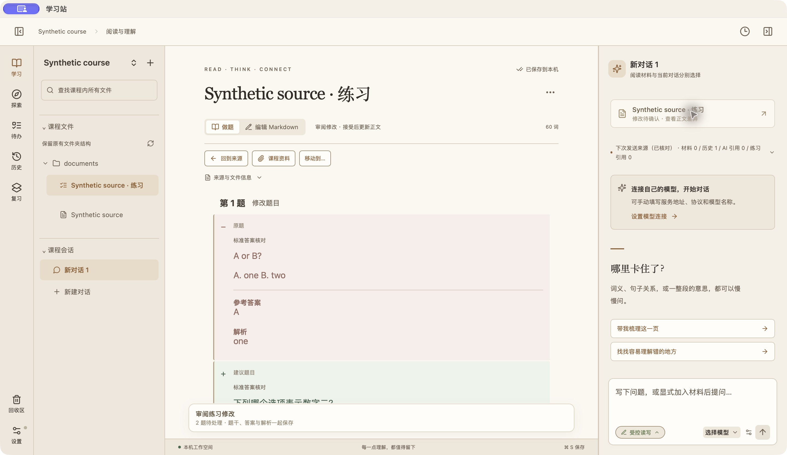
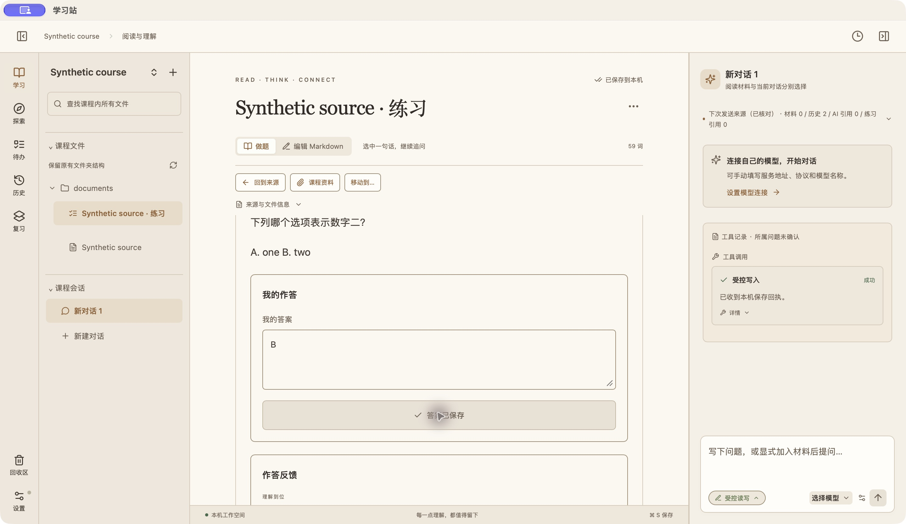

# 逐题审阅原生验收

2026-10-24，macOS 原生组合构建 `70dd4577abbc50289301926ba8def450c627eade`；练习层源码 `2d5b67e14aa84018d3b8545652e5f4299b53c33f`。使用独立合成课程和持久化状态，未连接真实模型、未修改用户课程。

- 原题与建议按整题展示，包含题干、选项、答案、解析；未修改题保持普通显示。
- 接受第一题后显示已保存，待处理数量从2变1。
- 拒绝新增题后保持2道题，审阅区与待审阅卡消失。
- 第一题原参考答案A，新参考答案B。实际作答B，显示答案正确及新解析。
- 退出再启动，修改后题目、答案B、正确评分仍保留；原始会话题目文件仍在，另有新题集记录。
- 侧栏新建菜单可见；折叠再展开保持当前练习。

首次原生测试在200330a发现接受按钮报“不支持的操作”：命令允许集合存在但nativeCall路由遗漏。已修复并新增真实nativeCall到模拟invoke的红绿回归，不再以替换整个api的组件测试代替路由验证。

差异截图取自200330a（修复仅涉及命令路由，布局相同）；以下保存评分截图取自70dd457。

验证：最新组合前端167项通过；此前同后端源码完整Rust528项通过、2项忽略；适配层150项通过。真实模型生成修改建议、多文件组合审阅、Windows尚未验收；本证据不替代本人验收或CI门禁。
