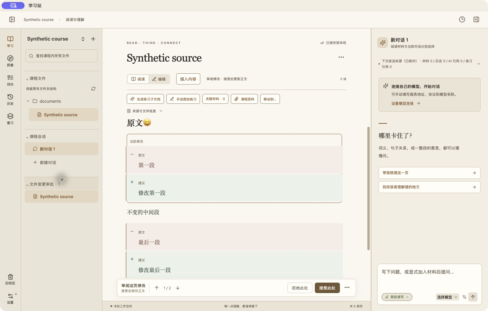
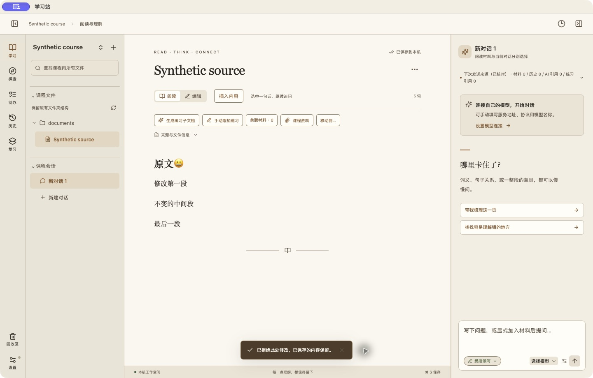

# 普通正文逐处审批验收

运行代码：`213f69a7be423062d71c980d6b7b8c6b10c5d8a8`，macOS Apple Silicon Release `.app`；后续仅补文档与截图。QA 使用同一二进制的独立副本、独立应用标识与临时资料库，普通交付包不含隔离标记。没有调用真实模型或改动用户课程。

## 自动检查

- 新增 Rust canonical 与生命周期 5 项通过：插入/删除/替换、中文/emoji、CRLF、末尾换行、代码围栏、持久决定、重启和重试、外部版本变化、撤权、草稿与未知结果恢复。
- 原有 proposal 回归 12 项通过；相关实际 React + 模拟原生 IPC 8 项通过；完整前端 168 项通过；类型检查与前端生产构建通过。
- `CARGO_TARGET_DIR=/tmp/ls-review-trash-target cargo test --locked --manifest-path src-tauri/Cargo.toml --no-default-features partial_review -- --test-threads=1`。
- `node --experimental-strip-types --test tests/edit-review.test.mjs tests/focus.test.mjs`；`npm test`；`npm run build`。
- `npm run tauri -- build --bundles app`：完整资源的 Mac 应用构建成功。CI 与原生审查结果在本 PR 单独记录，不能用本地结果替代。

## 实际应用

1. 点击侧栏待确认文件：显示两处独立修改，当前处高亮，底栏提供“拒绝此处”“接受此处”；上下导航定位当前处。
2. 接受第一处：真实文件只更新第一段；第二处仍待处理。
3. 关闭并重新启动：已接受第一段保留，第二处仍可决定；更多菜单包含接受/拒绝剩余修改。
4. 拒绝第二处：原第二段保持不变，已接受第一段保留；待审入口和底栏隐藏。
5. 核验归档提案：决定为 accepted/rejected，接受数和拒绝数均为 1；文件保留 CRLF。

## 边界与本人验收

真实在线模型、真实账户及其他平台未测。参考 VS Code 的逐处保留/撤销和导航交互，学习站仍在接受后才保存。请本人用最终交付包接受一处、拒绝另一处，并确认重开后内容；尚未本人验收，不据此合并或发布。

参考：[VS Code review code edits](https://code.visualstudio.com/docs/agents/run/review-code-edits#review-local-harness-session-changes)。
