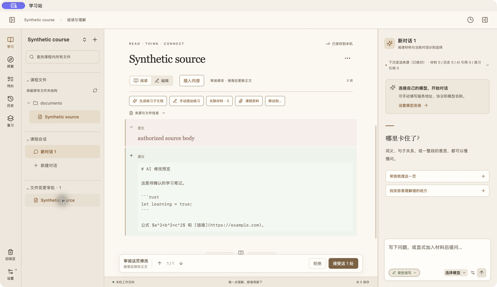

# 文件变更审批入口验收

## 版本与范围

运行代码：`f2a4fb9045cfe7789a8547f78b3d313bccb18046`。在课程侧栏复用课程文件的列表行，待确认修改可折叠、可定位，无待处理内容时隐藏。

## 自动验证

- 样式修正前组合版本 `19b9d1e`：前端 168 项、Pi sidecar 152 项通过。
- `f2a4fb9`：8 项相关回归与前端构建通过，包含实际 App 加模拟 IPC 的编辑草稿保留、同文档定位、多提案选择与不同文档读取检查。
- 模拟 IPC 不代替原生持久化验收或真实模型服务验证。

## 原生行为验收

macOS `19b9d1e` 隔离合成课程：打开笔记并编辑，点击审批入口可查看差异；未保存草稿存在时禁止接受，返回编辑仍保留输入；拒绝成功后整个审批分组隐藏，正文不被建议覆盖。该版本为旧卡片外观，其结果只覆盖行为。

## 本人验收

1. 打开有待确认修改的课程，左侧“文件变更审批”与课程文件使用一致的列表行。
2. 编辑文件后点击审批行，查看差异；返回编辑时草稿保留。
3. 按实际意愿接受或拒绝建议；没有剩余建议后，审批分组隐藏。

尚未验证 Windows / Linux；真实模型、用户原课程的修改接受由本人完成，不替代本人验收。

## 最终样式原生检查

macOS `f2a4fb9` 正式构建的隔离测试副本：展开课程文件，点击审批行成功定位正文差异；审批项复用文件树行，无白色卡片、独立边框或跳转箭头。未连接真实模型。

