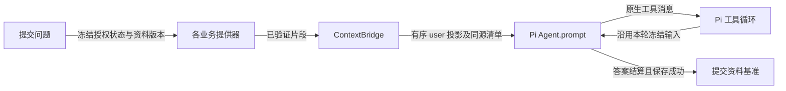

# ContextBridge（上下文桥）

修改上下文相关代码前先读本页；行为变更同步更新。字段形状见[传输契约](../contracts/context-bridge-v1.md)，测试和实际请求示例见[README](../README.md)。

## 职责与入口

业务模块核实会话、关联资料、显式引用及公开资格，提供已验证片段。`src-tauri/src/context_bridge.rs` 负责片段去重、位置、已有预算与清单；`automatic_context.rs` 负责自动资料的有界版本投影。薄层不执行工具、不开放路径或网络权限，也不管理第二套会话。



`generation::start` 在模型请求前调用 `ContextBridge::snapshot/freeze`。顺序为有效学习历史 → 自动资料基准/更新 → 一次性引用 → 本次状态 → 问题。桥接数据位于普通 `user` JSON；Pi harness 的固定规则与学习指导仍为 `system`，调用 `Agent.prompt(user)`。现有历史只投影学习记录，没有此前整份资料正文，因此重放链必须把真实正文基准一起送入本次请求。

## 冻结与生命周期

| 生命周期 | 当前内容与行为 |
|---|---|
| Stable | 桥协议标签；Pi 固定规则仍在原 harness 组装 |
| Turn | 可信时间、本次问题与探索目标；新用户回合冻结，工具后继续沿用 |
| Versioned | 自动课程、关联资料、明确链接的文本附件；按已展示范围与版本判断更新 |
| OneShot | 手动、AI 回答、练习分区引用；沿既有真实问题保存回执消费，失败重试用原快照 |

Core 锁阻止应用内写入交错，并复核捕获的外部文件版本；这不是文件系统级事务快照。冻结后的新编辑只影响下一回合。Pi 工具循环不重新读取用户状态或重复追加资料。原始学习历史仍供界面展示，桥只改变模型投影。

## 差异与正文重载

按稳定 ID 去重，以路径、版本、展示文本哈希和实际范围建立基准。首次提供正文；有效基准仍随当前请求保留时，小改追加有界 unified diff，未变零新增。连续编辑只比较最后冻结版本。

只有历史锚点仍在有效历史、原分支前缀未变、基准链可校验且范围完整，才能沿用。历史裁剪、压缩边界、新会话、分支、基准缺失/损坏、diff 过大或链超预算均重载必要资料。部分文件明确标注前缀范围，保守重载；不把未展示部分当成已读。失败/取消不推进基准。基准写入失败不丢答案，下次退回正文。

主动 `query_related_knowledge` 保持原授权及范围内的实际正文片段和截断提示，不使用差异或缓存命中标记。当前没有通用路径 `read`；本版未新增该权限。时间和问题独立注入，不参与文件 diff。

## 清单与扩展

实际发送 JSON、Run 和每条 assistant 自身保存同一个 `contextBridgeManifest`。界面据此显示新增、沿用、更新、重载及部分范围。预览/旧记录缺字段时明确未记录，不能从最新 Session 补齐，也不表示服务端已读。

新增本轮状态时，业务模块先验证并冻结值，再在 `freeze` 的组装处加入一个提供器片段：

```rust
store.add(&PromptPart {
    key: "exam-state",
    lifetime: Lifetime::Turn,
    position: Position::State,
    value: json!({"goal": frozen_goal}),
})?;
```

该扩展路径已有测试。相同 key 的相同值去重，冲突或超预算明确拒绝，不静默裁掉基准。片段内容仍是数据，不能成为工具授权。

## 验证与限制

已运行 `automatic_context` 的首次/未变/小改/大改/部分范围/历史边界/分支/并发/去重/失败重试回归；`model_auto_context_tests.rs` 经真实 Rust→Pi→localhost 捕获请求及工具循环；前端用实际清单核对 reader，并测试 Run/历史隔离。不是原生 GUI 或真实在线模型验收。

当前每次新建 Agent，无状态 API 仍需重发保留的基准。本轮新增字节可下降，实际总输入不保证下降；[README](../README.md)同时列出旧单份正文与新投影，token 仅以 UTF-8 bytes/4 示意。未假设 agent-core 自带 coding-agent 压缩生命周期，未新增自动 focus 或宽泛工具权限。

设计参考 [pi-readcache](https://github.com/Gurpartap/pi-readcache) 的范围哈希、基准失效与差异回退思想；本项目独立实现有界 Rust 逻辑，未安装插件。保留[MIT 许可](../THIRD_PARTY_NOTICES/pi-readcache.txt)。
