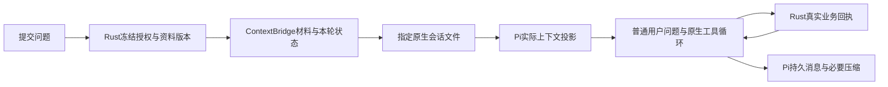

# ContextBridge（上下文桥）

修改上下文相关代码前先读本页；行为变更同步文档、[清单契约](../contracts/context-bridge-v1.md)与[原生会话契约](../contracts/pi-native-session-v1.md)。

## 职责与实际调用

Rust 核实资料授权、版本与显式引用；桥只冻结、去重、排列和限制片段。Pi 1.3.0 的 `SessionManager`/`AgentSession` 管模型消息、工具循环、压缩和指定文件恢复。Rust 的学习记录继续供界面、复习与回执使用，不再投影最近16条/单项5000/总计20000字符的历史到新 user JSON。上下文主链：底层接口（file_metadata/versioning）→ Focus 拼接 → ContextBridge 注册 → Pi 上下文 → 最终模型请求，底层接口契约见 [文件元数据与版本接口](file-metadata-and-versioning.md)。

`generation::start` 调用 `snapshot/freeze`，私有 stdin 传递 `nativeMaterials`、`nativeReferences`、本轮元数据与问题。适配器把材料/本轮状态写为明确的不可信 custom message，把本次问题写为真实 user 消息。旧模型历史由 Pi 恢复，不在此 JSON 中重建角色。批改、连接测试等原有无历史单轮任务保持隔离。

普通聊天与探索使用同一学习工具策略；工具集合与 Skill 正文、Focus/Citation/Changes/Time 的投影分开，制卡不需模式切换或先加载指导。question/explain 仍兼容已有请求与记录，不再注入“当前模式”作为聊天行为分流；场景指导沿现有单一快照入口提供，本次不新增上下文投影或会话映射。

课程内可以建立多个独立会话；`Session.courseId` 固定归属，`activeSessionByCourse` 只保存用户选择，不授予材料权限。旧固定课程会话及其 Pi 绑定保留为已有一条，不重编号、不拼接历史。创建、选择和改名不切换阅读文档；改名核对完整会话版本。

课程聊天请求的 `documentId` 为空或省略时不自动注入当前笔记或首次锚点。显式探索材料时才传真实文档编号并沿用冻结快照；附加引用也须属于本课程，独立探索保留已有显式引用语义。普通课聊没有 Focus 时不因切换笔记或会话增加来源；有效当前文本的自动 Focus 提供同次冻结完整正文。无明确材料来源的练习在模型调用和工具写入前返回 `SOURCE_REQUIRED`，不伪造练习父节点。

## 生命周期

Markdown 编辑器与课程聊天可粘贴 PNG/JPEG/GIF/WebP 图片，复用课程附件持久化回执和 `asset:` 引用，阅读与聊天直接显示本机预览。一次请求最多4张，每张最多5MiB；预览成功不表示模型已收到。

Rust 从本次问题和冻结材料正文中的显式引用提取同课程图片，经附件读取门禁及 `courseReadManifest` 版本检查后，通过独立 `images` 通道交给 Pi 原生 `AgentSession.prompt`。每个保存问题在私有 `image-snapshots` 中保留图片 ID/版本清单；重试复用该清单，版本变化、回收或跨课程均拒绝，不能把新图片替换进旧问题。图片字节不混入文本预算，也不伪造文字 manifest 的已读记录。

模型图片能力可在模型设置中选择自动、支持或纯文本，绑定当前供应商通道与模型；更换模型后恢复自动。自动仅采用锁版 Pi 模型目录中准确 ID 的一致能力，未知能力跳过；纯文本模型的当前图片与历史图片均不进入实际请求。原始附件和 Pi 持久记录保留，压缩仍由 Pi 管理。

Windows 原生会话检查点由 Rust 用可写文件/目录句柄及 `FILE_FLAG_BACKUP_SEMANTICS` 完成同步；Node 权限模式下不自行打开目录，仍等待 `session_sync` 的真实确认才继续。

| 内容 | 行为 |
|---|---|
| 固定规则与学习指导 | 显式应用规则；课程cwd沿Pi发现父级AGENTS/skills等文本，不加载外部可执行扩展或默认编码工具 |
| 时间、问题、探索目标 | 每个用户回合冻结；本轮工具续跑不重新读取用户状态 |
| Focus与明确提供的材料正文 | 开局不自动遍历；版本与差量经 versioning 接口取得（见[文件元数据与版本接口](file-metadata-and-versioning.md)）：file_stat 按未变/A/M/D·binary 定档，首见全文、有效完整基准后 file_diff 差量，无变化不重复，压缩或新session缺基准时恢复全文 |
| 手动、AI回答、练习分区引用 | 沿既有真实问题保存回执消费；模型失败重试使用原快照；旧 turn custom 通过原生 context edit 排除，不自动再注入 |

Core 锁覆盖应用写入并复核外部文件版本，不是多文件系统事务。冻结后新编辑属于下一回合。

## 基准与压缩

Rust 生成有界 full/diff 候选，并保留当前已授权的完整范围文本供重载。适配器检查 Pi `buildSessionProjection()` 中真实可见的 full→diff 哈希链：未变不新增；小改只在完整链仍在时追加；链缺失、部分范围、分支或压缩丢失 full 时重载正文。不能仅根据本机缓存存在就宣称模型仍有基准。Focus 部件即此形态：元数据＋版本hash＋diff（首见或丢基准时全文）＋课程级 stat 已并入同一部件（【Focus：当前文件】），diff 基准链随 Focus 条目保存；envelope 不再携带 paragraphs 正文与坐标投影，生命周期机制不变。

Pi 在已配置上下文容量时执行原生阈值压缩，通过同一受控模型/协议/凭据与输出预算产生摘要；摘要请求零工具、无自动换模型或服务。未知容量保持未知，不猜规格，不启用阈值压缩。新摘要完成后重新核验并补齐本轮必要材料。范围不完整时明确只含前缀；从未展示的尾部不算已读。

资料授权集合减少或回收历史保护触发时，使用明确的原生应用权限边界排除先前消息/摘要，再加入本轮授权资料。旧原始记录仍保留，未删除用户数据。主动 `query_related_knowledge` 仍返回授权范围内真实片段，不使用缓存标记代替读取。

## 同源清单

`Run.courseReadManifest` 单独保存课程可读来源与提交版本，不能渲染成已发送或已读来源；`Context.manifest` / `Run.contextManifest` 仍只列实际正文。Rust read 的 `delivery=tool-result` 与 `range` 描述本次实际回包，不表示远端已接收；Pi各session的工具消息、receipt及真实投影决定正文基准，不新增缓存。

Pi历史授权集合独立沿用课程可见来源，兼容旧course/folder/exercise编号，不以可读正文目录替换；仍授权的历史/摘要在升级时保留，真实移出课程、回收或撤权才建立权限边界。

Pi 确定实际材料投影后，把同一个 `contextBridgeManifest` 放进 turn custom message，并经私有管道交 Rust 写入 Run；答案保存时复制到该 assistant 自身。queued 初始值不冒充实际清单。界面不从最新 Session 回填旧回复，不新增路径打开。

此清单说明桥提供的资料/引用/状态，不是 Pi 全部原生历史消息目录，也不表示服务端已读或保证总 token 下降。预览或旧记录缺字段明确未记录。

## 持久化与失败恢复

稳定学习会话 ID 映射到私有 `pi-native/<hash>/transcript.jsonl`，只打开该文件，不用 `continueRecent`。首次保留旧 Markdown 与结构化备份；旧记录以明确引用导入，不补造缺失工具调用。

Node 继续使用权限模式，只能读运行组件及读写当前私有会话目录，无 child-process 权限。Node 24 在该模式下禁止 fsync，因此关键检查点经私有 `session_sync` 交 Rust 同步文件和目录，收到确认后才继续模型请求、工具执行或完成回执。

工具调用归属先持久化；Rust 业务提交后先保存完整回包日志再回复 Node。中断恢复先读原回包，缺失时只查询真实业务记录；无证据保持 unknown，绝不重做写操作。新业务操作 ID 绑定真实已保存问题、工具名与精确参数，因此同一问题恢复后即使换 run/call 编号，相同写入仍返回原对象；旧无问题绑定的记录保留原编号语义。read 的旧回执不能证明当前授权：每次重放或恢复（含已有原生回包）重新核实当前来源、课程、回收状态、原轮及本轮冻结版本与回执版本；不一致仅返回无正文错误，旧回执保持原样。明确读取拒绝配对为工具错误后允许继续，结果未知仍停止；write/bash 的持久幂等与只读恢复不变。映射/原生文件缺失、损坏、部分 JSON 行或符号链接均报错，旧 Markdown 不被覆盖。失败或取消不推进 Rust 资料基准。

## 验证边界

[README](../README.md)区分实际锁版 SDK、Rust→受限 Node→Pi localhost、React/mock IPC 和包资源验证。没有新增原生 GUI、真实在线模型、Anki、飞书或鼠标/IME 验收。

课程内自动 Focus 已按 [Focus v1](../contracts/focus-v1.md) 冻结身份、视图与固定 Git 材料，沿原请求用于重试与来源显示；无课程 legacy 会话保留兼容路径。通用网络权限未新增。HTML 预览只改变阅读视图，不增加模型来源授权；嵌入原文仍作为普通不可信笔记内容，远程网页/视频不抓取或自动加入上下文。原版本投影参考保留 [pi-readcache MIT许可](../THIRD_PARTY_NOTICES/pi-readcache.txt)，未安装插件。

最终练习 JSON 的修正沿同一原生会话和冻结来源进行，程序校验消息不作为用户新问题，也不重新冻结引用或增加来源授权；最多两次修正，来源越界不自动修正。详见原生会话契约的 `validate_output`。

Citation 沿用本页的保存回执与一次性生命周期，三类精确选区的位置/版本见 [契约](../contracts/citation-v1.md)。显式引用的必要邻段、同题已保存作答和状态按 [补充契约](../contracts/citation-context-v1.md) 单独冻结，保留真实范围、版本及截断标记；不会把补充当作用户原选区。引用选择本身不创建 Git；未交卷练习仍只读取经分区校验公开的原文。

## 课程归属与本轮材料

课程会话的稳定 ID 和本轮 `documentId` 分开：同课允许多个独立 Pi 对话；切换笔记/练习保持当前聊天，本轮材料、选区及练习落盘使用提交时的文档。旧练习页面沿原账本读取题目和作答，不把参考答案自动带入上下文。课程旧对话备份、历史入口与兼容行为见原生会话契约“课程会话路由”。统一 Focus 身份、视图及固定 Git 版本见 Focus v1；同一课程各对话分别维护原生实际接收基准。

练习页的本轮来源须通过原始账本映射校验；页面来源、origin 或 entry 被改写时在模型请求前报 CONTEXT_CONFLICT。请求接受后使用 Rust 保存的归一化 Run.sourceDocumentId；在途页面编辑不能改变练习落盘目标。跨课程移动的练习可读取原账本，但分区注入另按当前课程校验，不拼接原课程聊天。共享会话按 courseId 回收，单篇回收的历史排除边界按来源集合摘要记住，后续合法回合不会每次清空。

## 请求调试（M2 / #52）

唯一开关与查看入口为「设置 → 请求调试」，默认关闭，不写入偏好。Pi 的
`createControlledFetch` 在最终 `Request` 送入底层 fetch 时记录其真实 JSON
payload；不是 ContextBridge 预览，也不重新生成上下文。OpenAI / Anthropic、
工具后续、压缩与校正均复用同一边界，不增加模型调用。请求编号关联课程、
会话、request/run、独立 attempt UUID、阶段、模型与时间；HTTP 状态和运行结果
分别显示。失败后重试仍是新的实际发送记录，未发送的校验失败不生成条目。

Rust 每次发送前提供易失采集许可；关闭后清空并拒绝旧许可的迟到事件。
离开会话清除对应记录，旧会话在途请求不继续采集；重新选择后从新记录开始。
仅保留最近 40 条且总计最多 4 MiB，单请求体最多 256 KiB；超限整个 body 省略，
明确标为不完整，不将前缀冒充完整。diff 只比较同一 session 的上一实际请求，
基线淘汰或不完整则说明无法比较。工具名、参数和请求消息均来自该 payload。
正文视图将消息内 JSON 展开为路径和原文，便于核对 Focus、引用补充和 Changes。

认证头及未知头默认隐藏；结构化敏感字段、请求内存中已有 API key、常见认证
文本与重复凭证值在 sidecar 发出 IPC 前脱敏。没有原值显示、复制按钮、导出、
持久化日志或上传通道。用户可选中已脱敏文字；课程正文仍是私人内容。

### Debug 来源与注册键

「按来源 / 注册键」直接显示 `ContextBridge::add` 接受的 key、lifetime、position、
value；生产当前为 stable/materials/references/turn/question 五键。注册值是冻结输入，
不能当作最终发送投影。值超过 8 KiB 明示省略；关闭调试时不生成该内容快照，
调试晚于冻结开启或内部消息预算不足时可能缺少注册快照，界面明确说明。

nativeMaterials/nativeReferences/manifest、Pi 材料与 Changes 投影、harness 的系统说明
不因此被冒充为命名注册。来源定位从原生 projection 的真实 customType/消息角色及
Pi system.sections 取得，绑定到该次最终 Request 的字段/片段；不按正文关键词分类。
未匹配或同内容来源冲突标为未知，用户消息、工具返回、模型回复单列。

正文只呈现 messages/system，工具定义单独折叠，原始请求及完整 payload diff 保留。
桥内 JSON 仅按正常 JSON 解析展开，显示字符串真实换行，不全局替换代码字面量 \\n。
本批使用可折叠可读 log 和文字来源标签；未新增 JSON 高亮依赖或更改模型提示。

### 本轮新增与完整上下文

请求调试的「本轮新增上下文」只列实发来源中有注册键且可核实属于本用户轮的
桥部件，排除历史注册、原生问题和未定位来源；工具续跑仍属于同一用户轮，
不是与上一次 HTTP 请求做差量。「完整上下文」保留本次捕获的全部 system/messages，
包含历史、压缩摘要和工具调用/回包结构，来源缺失也不隐藏消息。
两个视图的阅读与 JSON 使用各自范围；冻结候选单独折叠，不能冒充实际新增。

### 课程工作区写入

课程write现在落在本课程materials，普通新文件由既有Git变化清单呈现，可用read(path)读取；不会自动建立业务笔记或增加本轮sourceId授权。已有笔记正文修改保留业务元数据，并要求读取版本，后续回合沿原冻结流程生成新的Focus。覆盖版本、新建与unknown回执语义见原生会话契约“课程工作区写入”。

课程工具写入的冲突副本位于材料内隐藏恢复目录，不进入材料捕获与模型正文。UNKNOWN只读核对原操作的恢复状态；不会通过改请求编号或覆盖第三份文件恢复。详见原生会话契约“冲突副本与中断恢复”。

## 用户轮次与唯一 Focus（#73 / #74）

用户主动发送保存的 `userEntryId` 是用户轮身份；同轮工具续跑、程序修正和原问题重试不重新冻结。每次实际 HTTP 请求仍有独立调试编号。进入新轮或重建本轮投影时，旧时间、一次性引用和当前 Focus 声明通过 Pi context edit 排除；探索入口保留其会话生命周期，普通用户、助手和工具历史不删除。

有效 `focus` 注册仅有 0 或 1 项，携带当前位置和本次 Changes/diff。全文使用独立 `materials` 注册，始终带来源路径，不重复声明当前 Focus。旧 Focus 若有 Pi 实际接收回执，将其材料/diff与课程变化降级为明确历史材料，保留原轮身份、完整 hash 链、偏移和接收回执；未送达候选直接排除。原始持久记录保留。无 Focus 的新轮不回填旧焦点；相同正文不同文件按稳定身份分别保留材料基准。压缩丢失基准仍经原机制补齐本轮正文。

验证覆盖锁版 Pi 与 localhost 实际 payload、接收回执及隔离合成会话；不代表原生桌面或真实在线模型已经验收。
## AI 文本修改审阅（#71）

课程 `write` 对可正常打开的业务文档先持久化针对准确文件版本的建议，回执 `proposalPersisted=true`、`persisted=false`、`status=pending`；正文和版本保持原状。普通 raw 材料按原授权和事务直接保存，不因扩展名生成无正常预览入口的提案；业务正文与基线完全相同则返回 unchanged，不生成空审阅。等待决定的工具活动为 waiting，生成中断后尚在执行的工具为 unknown，后续只凭真实回执结算。React 以课程提案文件 stamp 轻量核对变化，仅变动时读取提案，在当前页显示 Diff；其他文件只提供同一审阅入口，不改变当前文件或编辑缓冲区。未保存编辑阻止接受；接受期间新增的草稿仍保留并提示对照。

按本文件本次建议整体接受或拒绝。接受重新检查工具档位、课程/文件范围和版本，复用课程写入事务与恢复目录；真实发布回执先记入原操作 ledger，再保存提案状态。状态同步中断先查原 ledger，无法确认时保留 old/new 和外部文件，不重放。拒绝只保存决定。同文件未决建议串行，提案与原文基线跨重启保留。

生成工具 handler 等待用户决定后才把最终回执交给 Pi；期间可以停止生成，原有 120 秒总时限不延长，提案仍可随后审阅。恢复遇到 pending 返回未决错误，接受/拒绝后再核对原请求；不把尚未接受的正文作为模型已经写入的内容。无课程的会话草稿写入和 Bash 保持既有语义。Diff 使用有界 LCS；超出 200 万比较单元时以完整连续变化区显示，避免长文计算阻塞，不支持逐处接受。

### 审阅布局（本人批准的静态方案）

- 没有待处理建议时，不显示审阅标题、计数、空区域或常驻按钮；完成反馈复用现有短暂提示。
- 当前文档的差异在正文原位置显示，未变内容保留阅读排版；完整 Markdown 块参与比较，代码围栏、列表和表格不拆成不完整片段。变化区域有 `− 原文` / `+ 建议` 标识，不只靠颜色区分。阅读中的建议不是已保存原文，不作为原文选区引用。
- 本文件的上一处/下一处、接受/拒绝集中在正文底部紧凑操作栏。接受仍按整份建议，不将块级显示冒充逐处接受。结果未知时原位置提供核对入口；有草稿时保留编辑器及其内容，允许查看差异但禁接受。
- 聊天中的待审阅文件卡片只负责定位，不增加第二组决定按钮；文件显示学习目录中的标题。非当前文件不会自动切换。尚无正文页面的普通文件通过现有对话框复用同一差异与操作组件预览。
- 接受只有在真实落盘回执后刷新正文；拒绝保留原文。列表移除已终结提案后，界面也移除相应区域；晚到轮询不得重新展示刚处理的提案。窄窗口允许操作栏换行，键盘可操作导航和决定按钮。

### 中断核对与归档

接受前必须匹配初始工具 ledger；缺失或损坏时不发布，允许拒绝后重新请求。`accepting` / `unknown` 的结果核对不要求当前仍有 write 档位，核对不会重新执行发布。若能证明初始 pending ledger 身份一致且持久写入意图不存在，可恢复为待决定；存在意图或证据不一致仍保持未知。

相同文件已有未决建议时，新写入保留 CONFLICT，并通过固定诊断说明需要先审阅旧建议；不把它误报为 read 版本失效。真正的版本冲突要求重新读取，不使用 Focus Git OID 代替 write.expectedVersion。工具卡保持失败状态，原提案与正文均不被新请求修改。

用户决定会结算原 session/run 的工具活动，即使生成已经停止或应用重启。终结提案归档但保留按 ID 的恢复入口，列表只返回未决建议；旧平铺目录中的终结文件首次遇到时迁移。此生命周期不新增工具数量预算。

## 练习引用来源清单

ContextBridge 每个用户轮注册 `exercise_sources`，将同轮 `Context.manifest` 的 `sourceId/path/version` 显式提供给模型；普通聊天的 `generate_exercises` 与专用 practice 共用此清单。路径仅用于识别材料，`sourceIds` 必须填写稳定 ID。清单不包含课程可读目录或历史授权集合，不声明额外正文已读取；空清单也明确提供。旧轮清单沿 turn 生命周期排除，重试及压缩恢复使用原冻结快照。Rust 仍按原冻结 manifest 严格校验，不从文件名或路径猜测 ID，不将未知来源变成可自动修正的授权错误。

练习“编辑 Markdown”视图允许本轮显式读取该题集的结构化版本以提出整题修改；冻结时仅增加该文档ID的读取范围，不自动投影答案。做题视图保持原隐藏答案边界。接受审阅追加不可变修订，具体协议见 [IPC练习审阅](../contracts/ipc.md)。
