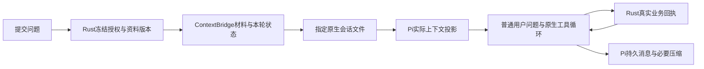

# ContextBridge（上下文桥）

修改上下文相关代码前先读本页；行为变更同步文档、[清单契约](../contracts/context-bridge-v1.md)与[原生会话契约](../contracts/pi-native-session-v1.md)。

## 职责与实际调用

Rust 核实资料授权、版本与显式引用；桥只冻结、去重、排列和限制片段。Pi 1.3.0 的 `SessionManager`/`AgentSession` 管模型消息、工具循环、压缩和指定文件恢复。Rust 的学习记录继续供界面、复习与回执使用，不再投影最近16条/单项5000/总计20000字符的历史到新 user JSON。

`generation::start` 调用 `snapshot/freeze`，私有 stdin 传递 `nativeMaterials`、`nativeReferences`、本轮元数据与问题。适配器把材料/本轮状态写为明确的不可信 custom message，把本次问题写为真实 user 消息。旧模型历史由 Pi 恢复，不在此 JSON 中重建角色。批改、连接测试等原有无历史单轮任务保持隔离。

## 生命周期

| 内容 | 行为 |
|---|---|
| 固定规则与学习指导 | 应用提供；不加载全局 Pi 配置、外部扩展或默认编码工具 |
| 时间、问题、探索目标 | 每个用户回合冻结；本轮工具续跑不重新读取用户状态 |
| 自动课程、关联资料、文本附件 | 版本化材料；实际 Pi 投影仍有完整基准才沿用或追加 diff |
| 手动、AI回答、练习分区引用 | 沿既有真实问题保存回执消费；模型失败重试使用原快照；旧 turn custom 通过原生 context edit 排除，不自动再注入 |

Core 锁覆盖应用写入并复核外部文件版本，不是多文件系统事务。冻结后新编辑属于下一回合。

## 基准与压缩

Rust 生成有界 full/diff 候选，并保留当前已授权的完整范围文本供重载。适配器检查 Pi `buildSessionProjection()` 中真实可见的 full→diff 哈希链：未变不新增；小改只在完整链仍在时追加；链缺失、部分范围、分支或压缩丢失 full 时重载正文。不能仅根据本机缓存存在就宣称模型仍有基准。

Pi 在已配置上下文容量时执行原生阈值压缩，通过同一受控模型/协议/凭据与输出预算产生摘要；摘要请求零工具、无自动换模型或服务。未知容量保持未知，不猜规格，不启用阈值压缩。新摘要完成后重新核验并补齐本轮必要材料。范围不完整时明确只含前缀；从未展示的尾部不算已读。

资料授权集合减少或回收历史保护触发时，使用明确的原生应用权限边界排除先前消息/摘要，再加入本轮授权资料。旧原始记录仍保留，未删除用户数据。主动 `query_related_knowledge` 仍返回授权范围内真实片段，不使用缓存标记代替读取。

## 同源清单

Pi 确定实际材料投影后，把同一个 `contextBridgeManifest` 放进 turn custom message，并经私有管道交 Rust 写入 Run；答案保存时复制到该 assistant 自身。queued 初始值不冒充实际清单。界面不从最新 Session 回填旧回复，不新增路径打开。

此清单说明桥提供的资料/引用/状态，不是 Pi 全部原生历史消息目录，也不表示服务端已读或保证总 token 下降。预览或旧记录缺字段明确未记录。

## 持久化与失败恢复

稳定学习会话 ID 映射到私有 `pi-native/<hash>/transcript.jsonl`，只打开该文件，不用 `continueRecent`。首次保留旧 Markdown 与结构化备份；旧记录以明确引用导入，不补造缺失工具调用。

Node 继续使用权限模式，只能读运行组件及读写当前私有会话目录，无 child-process 权限。Node 24 在该模式下禁止 fsync，因此关键检查点经私有 `session_sync` 交 Rust 同步文件和目录，收到确认后才继续模型请求、工具执行或完成回执。

工具调用归属先持久化；Rust 业务提交后先保存完整回包日志再回复 Node。中断恢复先读原回包，缺失时只查询真实业务记录；无证据保持 unknown，绝不重做写操作。新业务操作 ID 绑定真实已保存问题、工具名与精确参数，因此同一问题恢复后即使换 run/call 编号，相同写入仍返回原对象；旧无问题绑定的记录保留原编号语义。映射/原生文件缺失、损坏、部分 JSON 行或符号链接均报错，旧 Markdown 不被覆盖。失败或取消不推进 Rust 资料基准。

## 验证边界

[README](../README.md)区分实际锁版 SDK、Rust→受限 Node→Pi localhost、React/mock IPC 和包资源验证。没有新增原生 GUI、真实在线模型、Anki、飞书或鼠标/IME 验收。

课程内自动 Focus 已按 [Focus v1](../contracts/focus-v1.md) 冻结身份、视图与固定 Git 材料，沿原请求用于重试与来源显示；无课程 legacy 会话保留兼容路径。通用网络权限未新增。HTML 预览只改变阅读视图，不增加模型来源授权；嵌入原文仍作为普通不可信笔记内容，远程网页/视频不抓取或自动加入上下文。原版本投影参考保留 [pi-readcache MIT许可](../THIRD_PARTY_NOTICES/pi-readcache.txt)，未安装插件。

最终练习 JSON 的修正沿同一原生会话和冻结来源进行，程序校验消息不作为用户新问题，也不重新冻结引用或增加来源授权；最多两次修正，来源越界不自动修正。详见原生会话契约的 `validate_output`。

## 课程归属与本轮材料

课程会话的稳定 ID 和本轮 `documentId` 分开：切换同课程笔记/练习复用 Pi 对话，本轮材料、选区及练习落盘使用提交时的文档。旧练习页面沿原账本读取题目和作答，不把参考答案自动带入上下文。课程旧对话备份、历史入口与兼容行为见原生会话契约“课程会话路由”。本轮尚未实现统一类型 Focus 或 Git 冻结版本。

练习页的本轮来源须通过原始账本映射校验；页面来源、origin 或 entry 被改写时在模型请求前报 CONTEXT_CONFLICT。请求接受后使用 Rust 保存的归一化 Run.sourceDocumentId；在途页面编辑不能改变练习落盘目标。跨课程移动的练习可读取原账本，但分区注入另按当前课程校验，不拼接原课程聊天。共享会话按 courseId 回收，单篇回收的历史排除边界按来源集合摘要记住，后续合法回合不会每次清空。
